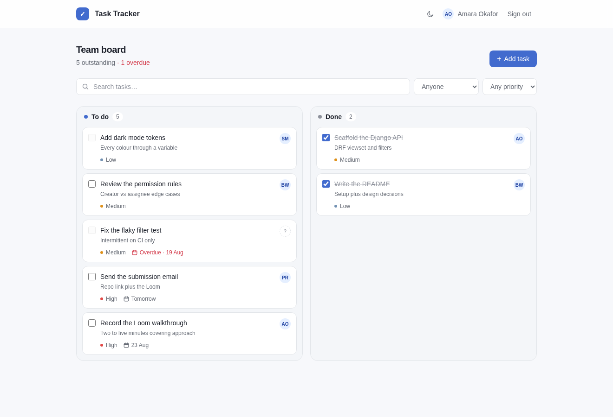
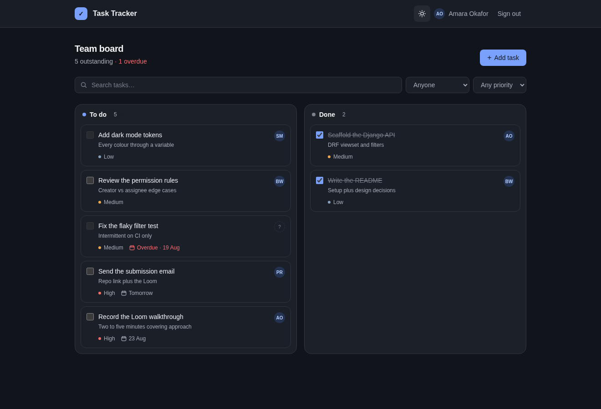
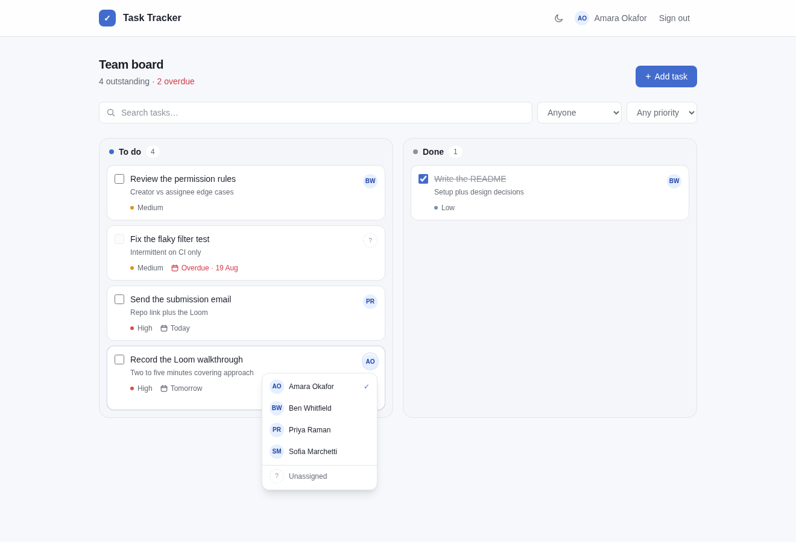
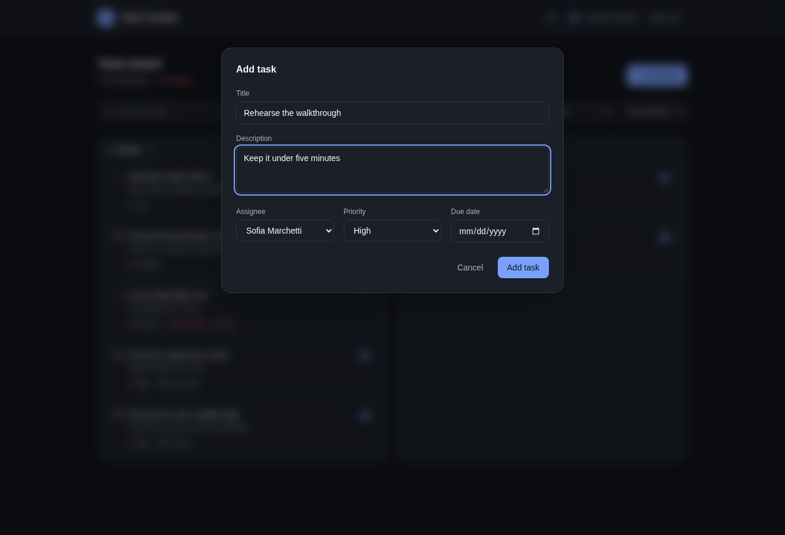

# Team Task Tracker

A task tracker for a small team. Tasks live on a two-column board, carry a
priority, a due date and an owner, and move between **To do** and **Done** by
drag, click or keyboard.

Built for the Spark Tutoring full-stack developer challenge.

**Stack:** Django 5 · Django REST Framework · PostgreSQL · React 19 ·
TypeScript · Vite · Tailwind CSS · TanStack Query
**Tests:** 38 backend · 43 frontend



---

## Contents

- [What it does](#what-it-does)
- [Screenshots](#screenshots)
- [Getting started](#getting-started)
- [Demo accounts](#demo-accounts)
- [API reference](#api-reference)
- [Data model](#data-model)
- [How it fits together](#how-it-fits-together)
- [Design decisions](#design-decisions)
- [Testing](#testing)
- [Project layout](#project-layout)
- [Known limitations](#known-limitations)

---

## What it does

Everything the brief asked for, plus all four optional extras.

| Requirement | Status | Where to see it |
| --- | :---: | --- |
| Add a task (title + description) | ✅ | **Add task** button → modal |
| Edit a task | ✅ | **Edit** on any card you own |
| Mark complete / incomplete | ✅ | Card checkbox, or drag between columns |
| Assign to a team member | ✅ | Click a card's avatar |
| List view: title, status, assignee | ✅ | The board itself |
| *Bonus:* filter and search | ✅ | Search box, assignee and priority filters |
| *Bonus:* due dates | ✅ | On each card; overdue work is called out in red |
| *Bonus:* priority levels | ✅ | High / Medium / Low, colour-coded |
| *Bonus:* login and sessions | ✅ | Real Django auth, not a mock |

Beyond the brief:

- **Per-user permissions.** You may edit and complete tasks you created or were
  assigned; only the creator can delete.
- **Reassign without opening the editor.** Click the avatar, pick a person.
- **Optimistic updates.** Completing and reassigning apply instantly and roll
  back with an explanation if the server refuses.
- **Light and dark themes**, following the system preference with a manual
  override.
- **Keyboard and screen-reader support.** Drag-and-drop is a shortcut, never
  the only route; the columns are labelled landmarks.

## Screenshots

| | |
| --- | --- |
|  **The board** — outstanding work on the left, finished on the right. |  **Dark mode** — follows the system setting, toggleable. |
|  **Reassigning** — the avatar opens the team list. |  **Add / edit** — one form serves both. |

## Getting started

**Prerequisites:** Docker, Python 3.11+, Node 20+.
[`uv`](https://github.com/astral-sh/uv) is used for Python dependencies; swap in
`python -m venv` and `pip install -e .` if you'd rather.

```bash
git clone https://github.com/sudee404/task-tracker-app.git
cd task-tracker-app
cp .env.example .env
```

**1 · Database** — Postgres in Docker:

```bash
docker compose up -d
```

**2 · Backend** — http://localhost:8001

```bash
cd backend
uv venv
uv pip install -e . && uv pip install pytest pytest-django
.venv/bin/python manage.py migrate
.venv/bin/python manage.py seed_team     # creates the four demo users
.venv/bin/python manage.py runserver 8001
```

**3 · Frontend** — http://localhost:5173

```bash
cd frontend
npm install
npm run dev
```

Open **http://localhost:5173** and sign in.

> **On the ports.** Postgres runs on `5433` and Django on `8001` rather than the
> usual `5432` / `8000`, because both were already occupied on the machine this
> was built on. Change them in `docker-compose.yml`, `.env` and
> `frontend/vite.config.ts` if you'd prefer the defaults.

## Demo accounts

Created by `manage.py seed_team`, which is idempotent — re-run it any time.

| Username | Name | Password |
| --- | --- | --- |
| `amara` | Amara Okafor | `password123` |
| `ben` | Ben Whitfield | `password123` |
| `priya` | Priya Raman | `password123` |
| `sofia` | Sofia Marchetti | `password123` |

The password comes from `SEED_PASSWORD` in `.env`. Signing in as different
people is the quickest way to see the permission rules: Sofia can't edit a task
Amara created and nobody assigned to her.

## API reference

Every endpoint requires an authenticated session; unauthenticated requests get
`403`. Responses are JSON, and list endpoints are paginated at 25 per page.

### Authentication

| Method | Endpoint | Purpose |
| --- | --- | --- |
| `POST` | `/api/auth/login/` | Sign in with `{username, password}`; sets the session cookie |
| `POST` | `/api/auth/logout/` | Ends the session |
| `GET` | `/api/auth/me/` | The current user; also refreshes the CSRF cookie |

### Tasks

| Method | Endpoint | Purpose |
| --- | --- | --- |
| `GET` | `/api/tasks/` | List tasks (filterable, searchable, paginated) |
| `POST` | `/api/tasks/` | Create a task |
| `GET` | `/api/tasks/{id}/` | Retrieve one task |
| `PATCH` | `/api/tasks/{id}/` | Update any field — including completion and assignment |
| `DELETE` | `/api/tasks/{id}/` | Delete a task (creator only) |
| `GET` | `/api/users/` | The team roster, for the assignee picker |

### Query parameters on `/api/tasks/`

| Parameter | Values | Example |
| --- | --- | --- |
| `search` | free text over title and description | `?search=loom` |
| `status` | `complete` · `incomplete` | `?status=incomplete` |
| `assignee` | user id | `?assignee=2` |
| `unassigned` | `true` · `false` | `?unassigned=true` |
| `priority` | `LOW` · `MEDIUM` · `HIGH` | `?priority=HIGH` |
| `due_before` | `YYYY-MM-DD` | `?due_before=2026-09-01` |
| `ordering` | `created_at` · `due_date` · `priority` · `title` (prefix `-` to reverse) | `?ordering=-due_date` |
| `page` | page number | `?page=2` |

They combine freely: `/api/tasks/?status=incomplete&priority=HIGH&search=deploy`.

Unsafe methods need Django's `X-CSRFToken` header. The frontend reads it from
the `csrftoken` cookie automatically.

## Data model

A single `Task` table alongside Django's built-in `User`.

| Field | Type | Notes |
| --- | --- | --- |
| `title` | `CharField(200)` | Required; whitespace trimmed |
| `description` | `TextField` | Optional |
| `is_complete` | `BooleanField` | Defaults to `false` |
| `priority` | `CharField` | `LOW` · `MEDIUM` · `HIGH`, defaults to `MEDIUM` |
| `due_date` | `DateField` | Optional |
| `assignee` | `FK → User` | Nullable; `SET_NULL` so removing a person doesn't delete their work |
| `created_by` | `FK → User` | Nullable; used by the permission rules |
| `created_at` / `updated_at` | `DateTimeField` | Managed automatically |

Tasks are ordered incomplete-first, then newest-first.

The serializer also returns `can_edit` and `can_delete` per task, so the UI can
hide controls the caller may not use. They mirror the permission class — they
don't replace it; the API enforces the rule independently.

## How it fits together

```
frontend/  Vite + React + TS   :5173  ──/api──▶  backend/  Django + DRF  :8001  ──▶  Postgres :5433
```

Vite proxies `/api` to Django, so the browser sees a single origin. That is what
lets Django's own session and CSRF cookies work end to end — no CORS
configuration, and no tokens sitting in `localStorage`.

**Backend.** A DRF `ModelViewSet` covers the task lifecycle; filtering and
search ride on the list endpoint via `django-filter` rather than bespoke
endpoints. `TaskPermission` decides who may change what. Team members are real
Django users, so one table serves both authentication and the assignee picker.

**Frontend.** A typed `fetch` wrapper handles the CSRF header and turns DRF's
error payloads into field-level messages. TanStack Query owns all server state:
mutations invalidate the task list and the view refetches itself, so there is no
second copy of the data to keep in sync. `AuthProvider` calls `/api/auth/me/`
once on boot to choose between the login screen and the board.

**The board.** To do and Done are two independent queries (`?status=incomplete`
and `?status=complete`), each with its own count and its own *Load more*. Cards
move between them by native HTML5 drag — no library.

## Design decisions

The brief said the interest was in approach, so here is the reasoning behind the
choices that weren't obvious.

**Completion is a `PATCH`, not a custom action.** Ticking a checkbox and editing
a title travel the same code path. One less endpoint to document, test and
secure.

**Two column queries, not one list split in half.** Paginating a single list and
dividing it client-side would let page two arrive entirely Done, leaving To do
looking empty. Separate queries keep each column's count and paging honest.

**Drag is never the only route.** Dropping a card on a column completes it, but
every card keeps its checkbox, so the board is fully usable from the keyboard
and by screen readers. Columns are named landmarks for the same reason.

**Team members are real users, not a hard-coded list.** The brief permits
hard-coding, but login was in scope anyway — one `User` table feeding both auth
and assignment beats two sources that can drift apart.

**Permissions favour the people with a stake.** Creator *or* assignee can edit
and complete; only the creator can delete, so an assignee cannot destroy work
someone else is tracking.

**Optimistic where it's safe.** Completion and reassignment apply immediately
and roll back on refusal. Both go through one helper rather than two copies of
the snapshot-patch-rollback dance.

**Errors surface where they belong.** Validation errors (`400`) render beside
the offending field and raise no toast — a toast would only repeat them less
usefully. Everything else (`403`, `404`, network) raises one, because it would
otherwise fail silently. Users never see DRF's own wording: a `404` body reads
"No Task matches the given query"; the toast says the task no longer exists.

**One token layer, two themes.** Every colour is a CSS variable; dark mode
redefines the variables and nothing else. `--color-on-accent` exists because
white reads against the light-mode accent but fails against the lighter
dark-mode one.

**Postgres in Docker, SQLite in tests.** Production-shaped locally, while the
test suite still runs in under a second with nothing to start first.

**No router.** The app has two states, not two routes. `App` renders either the
login screen or the board; a router would be ceremony.

## Testing

```bash
cd backend  && .venv/bin/python -m pytest   # 38 tests
cd frontend && npm test                     # 43 tests
```

The backend suite runs on in-memory SQLite, so it needs no container. It covers
task CRUD, the completion toggle, assignment, validation, every filter and
search path, the session endpoints, and each branch of the permission rules.

The frontend suite uses Vitest, Testing Library and MSW. It covers the board
split, optimistic completion and its rollback, drag-to-complete, reassignment,
debounced search, the permission-driven UI, theming, and the error-message
mapping.

Also available: `npm run lint`, `npx tsc -b --noEmit`, `npm run build`.

## Project layout

```
├── backend/
│   ├── config/            Django settings, URLs, WSGI
│   ├── accounts/          Session login / logout / me
│   ├── tasks/             Task model, serializers, viewset, filters, permissions
│   │   └── management/    seed_team command
│   └── tests/             pytest suite (SQLite settings live here)
├── frontend/src/
│   ├── api/               Typed client, endpoints, React Query hooks
│   ├── auth/              Session context and provider
│   ├── components/        Board column, task card, form, filters, assignee picker
│   ├── pages/             Login and board
│   ├── theme/ toast/      Theme switching, notifications
│   └── test/              MSW handlers, fixtures, render helpers
├── docs/screenshots/
└── docker-compose.yml     Postgres 16
```

## Known limitations

Worth knowing before reading the code, and the first things I'd pick up next.

- **Keyboard drag.** Moving a card between columns without a mouse means the
  checkbox, not a drag gesture.
- **No real-time updates.** Two people on the same board see each other's
  changes on the next refetch, not immediately.
- **The assignee menu doesn't flip.** It always opens downward, so on a card at
  the very bottom of a long board it can run past the viewport.
- **Editing needs the modal.** Assignment and completion are inline now;
  retitling still costs three clicks.
- **No activity history.** "Who completed this, and when" isn't answerable.
